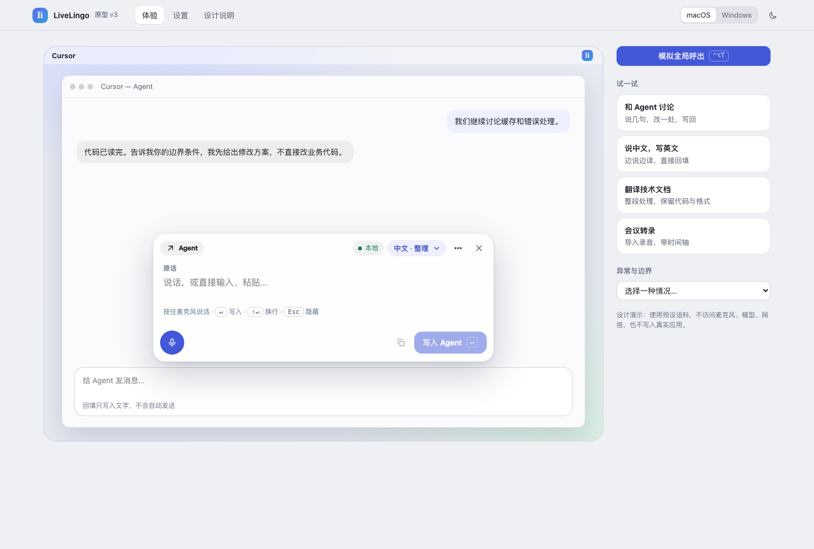

# LiveLingo

Voice dictation and translation that stay on your computer. Press a hotkey in any app, speak or type, and the finished
text is written back into the input box you were using.

LiveLingo 2.0 is a rewrite around one small window, the *composer*. The 1.x translator overlay is gone; its last
release is tag `v1.4.2`.



## How it works

1. **Summon** with a global hotkey (default `Ctrl+Alt+T`). The composer opens above the input box you were in.
2. **Say it or type it.** Tap the microphone to talk hands-free, or hold it to talk while pressed. You can also
   paste text or import a WAV recording.
3. **Pick what is written**, with one control: *Clean up* (fillers, repetitions and homophone errors removed, meaning
   untouched), *Translate to English / Chinese*, or *Original*. Your original words stay visible and can be restored for
   any sentence.
4. **Press Enter.** The result goes into the app you came from. If that window is gone, nothing is typed anywhere
   else; copy still works.

Cleanup is checked by a fidelity gate: a rewrite that adds facts, drops negations or numbers, or drifts from what you
said is rejected and that sentence keeps your words.

Imported recordings become a read-only timeline that goes through the same cleanup and translation, and can be
exported as SRT.

## Privacy

- Speech recognition, cleanup and translation run locally. Audio never leaves the machine.
- Cloud models are **off by default**. In *Settings → Privacy and cloud* you can switch translation and cleanup to your own
  OpenAI-compatible endpoint (for example Microsoft Foundry) separately. Only the text of that step is sent; the
  endpoint must be `https`; the API key is kept in the system secret store, not in a file. A cloud failure is shown,
  never silently retried on the local model.
- Models are downloaded only after you agree, from their original hosts, and verified against pinned SHA256 hashes.
- Recent drafts are kept in memory only and are gone when the app exits.

## Models

| Role | Model | Size |
|---|---|---|
| Live recognition | X-ASR 480 ms streaming (zh-en) | ~130 MB |
| Settled recognition and recording import | Qwen3-ASR 0.6B | ~880 MB |
| Speech boundaries | Silero VAD | <1 MB |
| Cleanup | Qwen3.5 4B Q4_K_M | ~2.7 GB |
| Translation (balanced) / (quality) | Hy-MT2 1.8B / 7B Q4_K_M | ~1.1 GB / ~4.6 GB |
| Runtime | llama.cpp b11980 | ~16–24 MB |

Licenses are listed in [THIRD_PARTY_NOTICES.md](THIRD_PARTY_NOTICES.md).

## Requirements and status

- Target hardware: Apple M2 or newer with 16 GB, or an equivalent Windows 11 PC. macOS 12+ and Windows 10/11.
- macOS needs Accessibility (to type into other apps) and Microphone permission.
- Developed and measured on an M3 Pro (36 GB). **Not yet verified:** an M2/16 GB machine (memory with all models
  resident, latency), anything running on Windows beyond a successful build and bundled native libraries, and a real
  Foundry/OpenAI endpoint.
- Recording import reads uncompressed WAV only. m4a/mp3 need a platform decoder that is not built yet.
- The project license is not chosen yet; there is no `LICENSE` file.

## Build and test

```bash
dotnet tool restore
dotnet run --project src/LiveLingo.Desktop       # run
./build.sh Test                                  # unit tests with coverage gates
./build.sh ProbeVoice --ProbeCorpus poc/voice-dictation/corpus   # end-to-end voice probe (downloads models)
```

See [CONTRIBUTING.md](CONTRIBUTING.md) for the project layout, build targets and rules.

## Design

- [Composer design](docs/superpowers/specs/2026-10-31-livelingo-composer-design.md)
- [Implementation plan and progress](docs/superpowers/plans/2026-10-31-composer-implementation.md)
- [UI prototype v3](docs/superpowers/prototypes/livelingo-ux-v3/README.md) (open `index.html` in a browser)
- Evidence behind the choices: [voice dictation design](docs/superpowers/specs/2026-10-29-voice-dictation-design.md),
  [translation POC report](poc/text-translation/REPORT.md)
