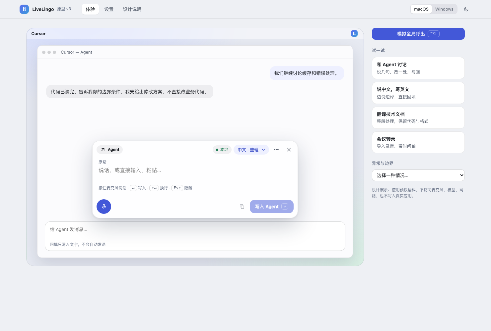
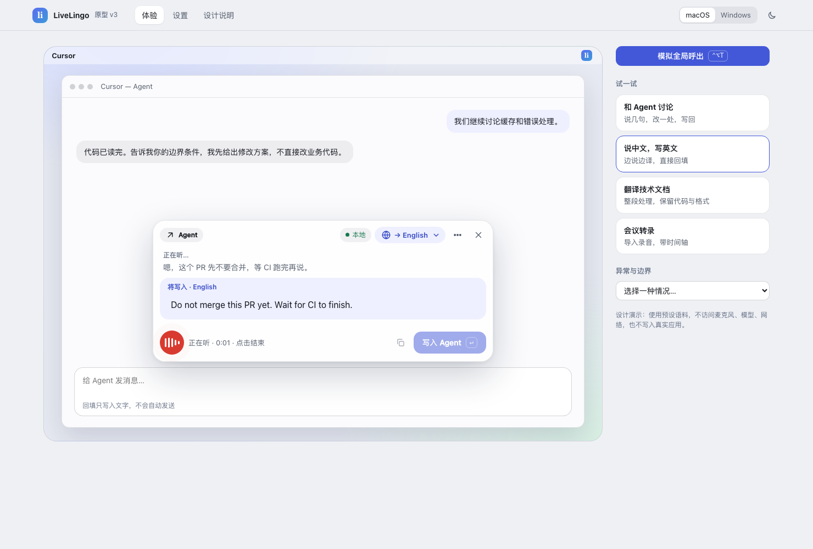
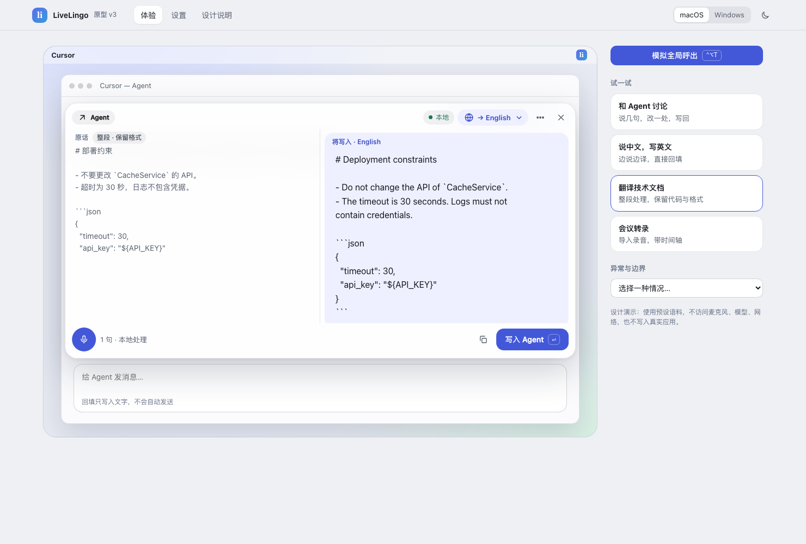
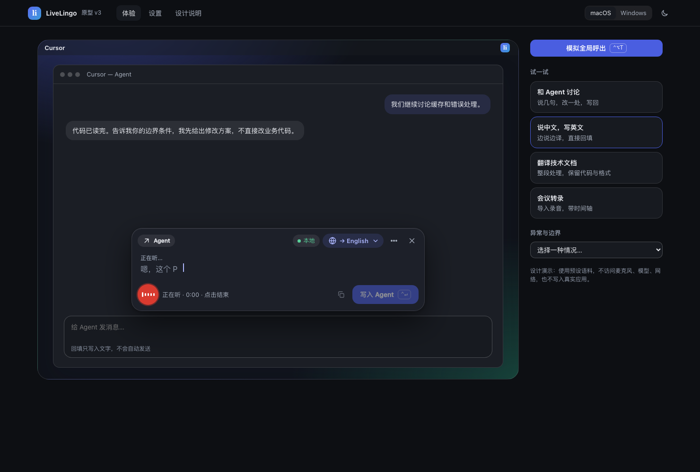
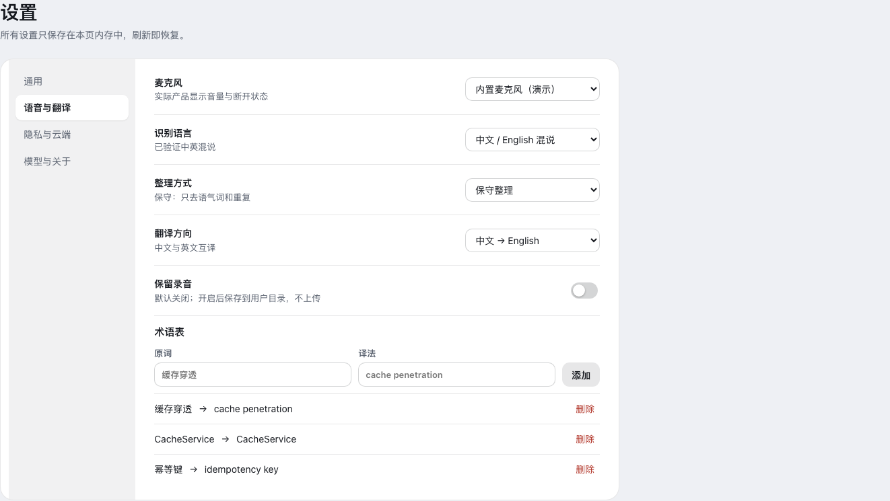
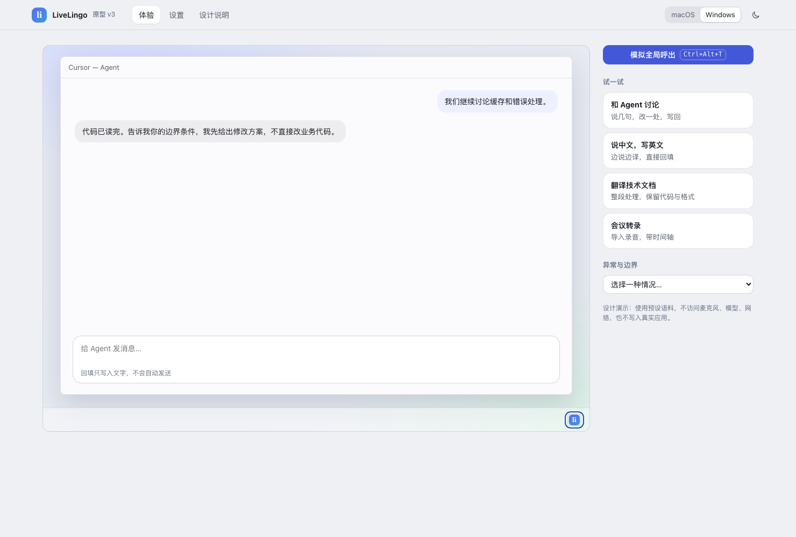
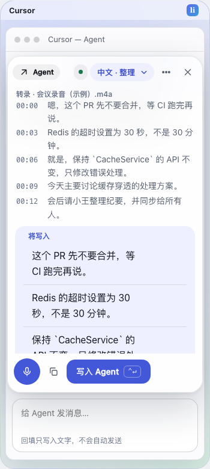

# LiveLingo 产品原型 v3

直接用浏览器打开 [index.html](./index.html)，无需服务器。这是交互设计演示，不是产品实现：使用预设语料，不访问麦克风、模型、网络，也不写入真实应用。上一版见 [v2](../livelingo-ux/README.md)。



## v2 有哪些问题（实测）

在同一台机器、1480px 宽下量化 v2 浮窗（待命 / 听写 / 审阅三种状态）：

| 指标 | v2 | v3 |
|---|---|---|
| 静止时可点控件 | 18 / 21 / 27 | **8 / 7 / 8** |
| 小于 12px 的文字片段 | 15 / 20 / 31（最小 9px） | **0 / 0 / 0** |
| 字号种类 | 9 / 7 / 7 | **3 / 4 / 4** |
| 浮窗高度 px | 463 / 424 / 528 | **234 / 258 / 416** |

具体问题：

1. **同一件事拆成四个控件。** “写什么”被分散在模式页签（听写 / 文字 / 转录）、翻译开关、方向下拉、输出页签（整理稿 / 译文 / 识别原文）里，用户要先理解它们的关系。
2. **每句常驻噪音。** 每句都带编号行、状态文字和三个下划线链接，三句话就是 9 个文字链接，正文反而淹没。
3. **字太小。** 页脚提示、元信息多为 9–11px，低于可读下限。
4. **页脚三层。** 操作条、按钮行、两行小字提示叠在一起，每次呼出都要先“读一遍界面”。
5. **异常靠弹窗。** 没声音、没权限、模型下载中都弹出对话框，打断本来还能继续打字的人。
6. **回车遇到“处理中”只提示**，用户要等一下再按一次。
7. **定位靠固定偏移。** 浮窗与输入框的间距随内容高度需要手调。
8. **页面冗余。** “状态全景”只是把场景再列一遍；设置分 6 页，每页都有大段说明。

## v3 做了什么

| 主题 | 做法 |
|---|---|
| 一块输入区 | 上面是“原话”（说的或写的，可编辑），下面是“将写入”。说话和打字共用；不再有模式页签。 |
| 一个输出胶囊 | 右上角胶囊选 **整理 / 翻译成 X / 原话**，并可互换语言方向。 |
| 句子操作悬停出现 | 编辑、改用原话只在悬停或键盘聚焦时出现；触屏常显。听写中不显示，避免列表在录音时被冻结。 |
| 单行页脚 | 麦克风 · 状态 · 复制 · 写入。键盘提示只在空草稿时显示一次。 |
| 麦克风一个控件 | 点按 = 免按住听写，再点结束；按住超过 350 ms = 按住说话，松开结束；键盘 Enter / Space 也可操作。去掉了暂停按钮：结束后再点即续录追加，效果相同。 |
| 回车排队 | 处理中按回车显示“完成后写入”，完成后自动写入；再按回车不取消，Esc、任何编辑、切换输出、失败或点按钮才取消。 |
| 异常用横幅 | 没声音、没权限、模型下载、处理很慢都是浮窗内横幅，打字照常可用。 |
| 失败不伪装 | 演示语料之外的文本没有译文，行内明确提示并提供重试 / 手动输入；整理在语料外保持原文。 |
| 自适应布局 | 浮窗锚定在输入框上方向上生长；整段文本或转录自动展开为左右对照，窄屏自动堆叠。 |
| 现代视觉 | 毛玻璃浮窗、统一圆角、单一强调色、骨架屏代替“处理中”文字、SVG 图标、浅色 / 深色 / 减少动画、macOS 与 Windows 样式。 |
| 更少页面 | 体验 / 设置 / 设计说明三页；设置 4 组：通用、语音与翻译、隐私与云端、模型与关于。能力没有减少，只是归并并压缩文案。 |





 

## 验证

```bash
node --test draft.test.cjs                      # 21 个状态模型测试，无第三方依赖
NODE_PATH=<含 playwright 的 node_modules> node browser.test.cjs   # 28 个 Chromium 场景，并重新生成截图
```

浏览器场景覆盖：录音中可见译文且不可提交；点按 / 按住麦克风；打字后回车排队写入；语料外文本不伪造译文；悬停工具、编辑与“改用原话”；整理被拒；整段路径与自动宽屏；目标失效、无输入框、转录时间轴；四种横幅；菜单键盘操作；Esc、全局快捷键、历史；输入法与 Shift+Enter；设置、独立云端授权、术语规则；浅色 / 深色 WCAG AA 对比度（设计令牌）；全页无 12px 以下文字；Windows 样式；390px 无横向溢出且浮窗不遮挡输入框；零脚本异常、零网络请求。

**独立复核发现并修复的三个缺陷**（均有回归测试，并经“撤销修复→变红→恢复→变绿”验证）：慢速模式下“改用原话”后切回整理会永远转圈；在“设置”页按 Enter / Esc 会作用于看不见的浮窗；编辑某句时再改原文，列表冻结且编辑被静默丢弃。

## 边界与未验证

- 这是视觉与交互设计，不证明识别 / 翻译质量或延迟；“更好的体验”需要真人任务验证：首次完成率、误回填率、修改成本、长口述恢复。
- 对比度只验证了设计令牌，没有逐一验证叠在毛玻璃之上的实际合成色。
- 按住 350 ms 的阈值是起点，需用户测试；OS 全局热键、跨应用光标捕获与回填、Windows 实机、M2 / 16 GB 上语音 + 整理 + 翻译的联合调度都未验证。
- 术语表只做界面演示，预设译文不会应用术语。系统声音、说话人分离、语音合成没有已验证方案，不提供入口。
- 保真检查只能提示风险，不能证明语义正确；原话始终可见、可回退。
