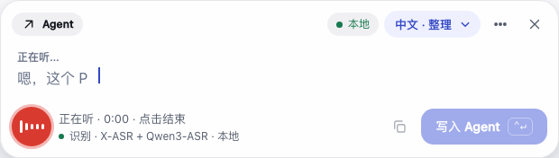
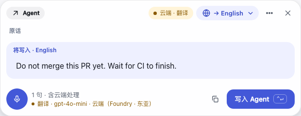
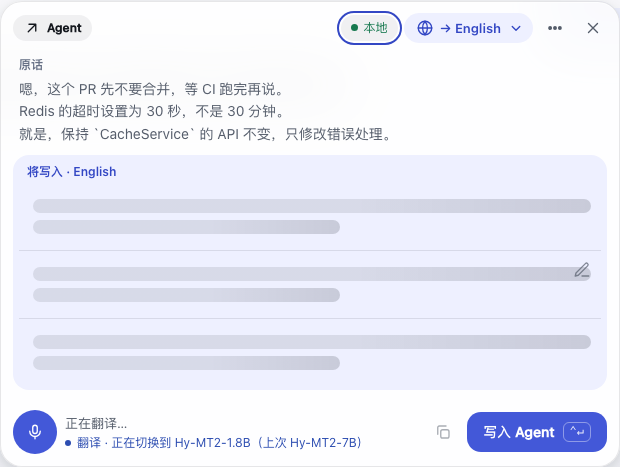
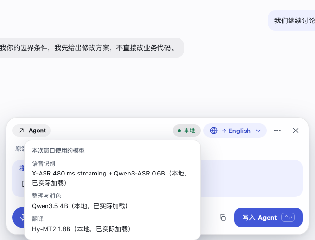
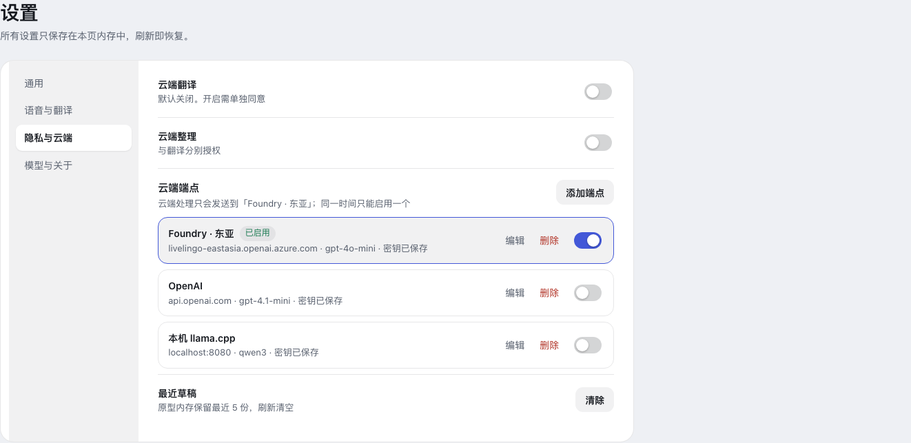
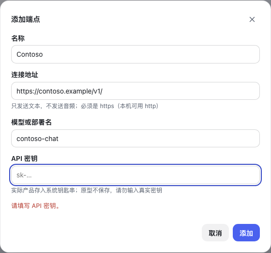

# LiveLingo 产品原型 v4：多云端端点 + 模型状态行

直接用浏览器打开 [index.html](./index.html)，无需服务器。这是交互设计演示，不是产品实现：不访问网络、不保存密钥。v4 复制自 [v3](../livelingo-ux-v3/README.md)，改了两处：**「设置 → 隐私与云端」**（多云端端点）和**浮窗底部的模型状态行与详情卡片**。两处均已在产品里实施。其余沿用 v3。

## 模型状态行：用一行字取代居中的浮框



### 现在的问题

语音输入一开，浮窗正中会弹出一个深色浮框（toast）写“当前用的是什么模型”，约 5 秒；整理、翻译每用到一个模型还会再弹一次。它盖在正在出现的转写文字上，颜色最重、位置最显眼，却只是个次要信息。

### 设计

| 项 | 规则 |
|---|---|
| 位置 | 麦克风按钮右边，状态文字的**正下方**，是页脚里现有状态文字的第二行。页脚高度不变（仍是麦克风 44px 加内边距），不盖任何内容，没有新控件 |
| 样式 | 12px、次要色，前面一个 6px 圆点；超长在行内省略，完整文字在悬停提示里 |
| 内容 | `阶段 · 模型 · 来源`。例：`识别 · X-ASR + Qwen3-ASR · 本地` |
| 显示哪个阶段 | 听写时显示语音识别模型；不在听写时显示当前输出对应的模型：整理显示整理模型、翻译显示翻译模型；输出为“原话”时整行隐藏 |
| 何时出现 | 一开始听写就出现，并一直在，不会自己消失、不用点。整理、翻译在有内容后才显示 |
| 加载中 | 蓝色圆点轻微呼吸：`识别 · 正在准备 X-ASR + Qwen3-ASR`、`翻译 · 正在切换到 Hy-MT2-1.8B（上次 Hy-MT2-7B）` |
| 云端 | 琥珀色，写明实际发出去的模型和端点：`翻译 · gpt-4o-mini · 云端（Foundry · 东亚）`，与右上角的“云端”标签同色，一眼能看出文本去了云端 |
| 无障碍 | 与状态文字同为礼貌播报（aria-live polite）；本地且稳定时文字不变，不会反复播报 |
| 窄窗口 | （仅原型的小屏演示）与状态文字一起隐藏；完整信息仍在右上角标签的卡片里。产品里的浮窗固定宽度，没有这条规则 |
| 减少动画 | 呼吸动画遵守“减少动画”设置和系统偏好 |

| 云端 | 加载中 |
|---|---|
|  |  |

在原型里用左侧“异常与边界”的“语音模型准备中”“翻译模型切换中”查看加载状态；云端状态在设置里启用端点并开启云端翻译后即可看到。

### 详情卡片



点右上角的“本地 / 云端”标签，在标签下方出现一张小卡片，列出语音识别、整理与润色、翻译三个阶段各自实际用的完整模型（本地已加载、云端服务返回的模型名，或“本次窗口尚未使用”）。取代原来居中的 10 秒浮框；Esc 或点别处关闭，不会自己消失。

### 为什么这样设计

- 次要信息用次要的呈现：常驻的一行小字，不抢注意力，也不需要用户去关。
- 弹出内容是瞬时的，错过就没有了；一行字可以随时扫一眼确认“现在到底在用谁”，对云端尤其重要。
- 和现有结构一致：状态文字本来就在这个位置，只是多一行；不增加控件，原型的控件预算测试（静止时 6–9 个）不变。

### 实施情况（已完成，三个待确认项均按原型）

你确认了：不听写时也常驻；使用短名称；右上角标签的详情一并改成卡片。已在产品里实施：

- 去掉居中的自动 toast（`ComposerWebSession.ShowModelHint`）。模型使用的事件现在只更新快照：页脚新增 `footer.model { text, tone, title }`，`tone` 为 `local / info / cloud`。
- 短名称来自模型清单（`ModelDescriptor.ShortName`：`Hy-MT2-1.8B`、`Hy-MT2-7B`、`Qwen3.5 4B`、`X-ASR`、`Qwen3-ASR`）；云端用服务返回的模型名，并带上端点名（`ModelUse.Endpoint`，由实际发请求的端点决定，不是设置里当前的那个）。完整名称留在悬停提示和卡片里。
- 右上角标签点击改为贴着标签的卡片（页面本地状态，不再发 `modelInfo`、不再用 10 秒 toast），列出三个阶段的完整实际模型；Esc 或点别处关闭。
- 本地模型的“模型状态行”不会自己消失，也不需要点击。

原型里的这个标签因此也成了按钮，控件数为 9 / 8 / 9（静止 / 听写 / 审阅），仍在预算内（6–9、6–9、6–10）。

---

# 多云端端点（v4 第一部分，已实施）



## 要解决的问题

现在云端翻译只有一个连接地址（`CloudSettings` 的一组 BaseUrl / Model / 密钥）。想换服务商或在两个部署之间切换，只能覆盖重填。

## 设计

| 项 | 规则 |
|---|---|
| 添加 | 可保存任意多个端点。每个端点有名称、地址、模型或部署名、自己的 API 密钥 |
| 启用 | 同一时间**最多一个**启用（用开关，不是单选，所以也可以全部停用）。启用 B 会自动停用 A |
| 默认 | 新添加的端点默认**不启用**，添加不会改变文本去向 |
| 云端开关 | 「云端翻译」「云端整理」仍是两个独立同意，都使用当前启用的端点；同意框写明端点名称与域名 |
| 没有启用的端点 | 云端开关打不开，提示先启用一个端点 |
| 切换 | 云端开着时启用另一个端点，先确认并写明新的去向 |
| 停用 / 删除 / 改域名 | 关闭云端开关并提示，需重新同意；不会静默改发或回退 |
| 校验 | 名称必填且唯一；地址必须 https（仅 localhost 可用 http）；模型必填；新建时密钥必填，编辑时留空即保持不变 |
| 删除 | 确认后同时删除该端点的密钥 |



## 实施情况（已完成）

- 设置模型：`Cloud.BaseUrl / Model` 变为端点列表加一个“已启用端点”的 id。旧设置迁移成一个名为“Default”的端点；原来云端开关为开的则迁移后启用，否则不启用。
- 密钥：每个端点一个 secret id（旧端点沿用原来的 `cloud-api-key`），删除端点时一并删除。
- `CloudRoute` 与 `RoutedChatClient` 不变：仍只拿到“当前启用端点”解析出的一条路由。
- 设置页的 Web 状态与 intent：新增端点的添加、编辑、删除、启用，校验在 view model 里。
- 诊断页仍不包含端点、密钥。

三个待确认项均按原型实施：允许全部不启用；翻译与整理共用同一个启用端点；切换端点、改域名后一律要求重新同意。

## 验证

```sh
npm i playwright && npx playwright install chromium   # 仅首次
node draft.test.cjs
node browser.test.cjs    # 含新增场景：多端点、单启用、切换确认、停用/改域名关闭云端、删除与空状态、模型状态行
```

30 个浏览器场景全部通过；运行时无脚本错误、无网络请求。静止、听写、审阅三种状态的浮窗高度与 v3 相同（234 / 258 / 416 px），控件数不变。
