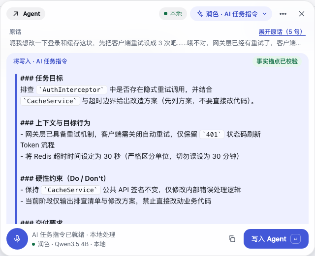
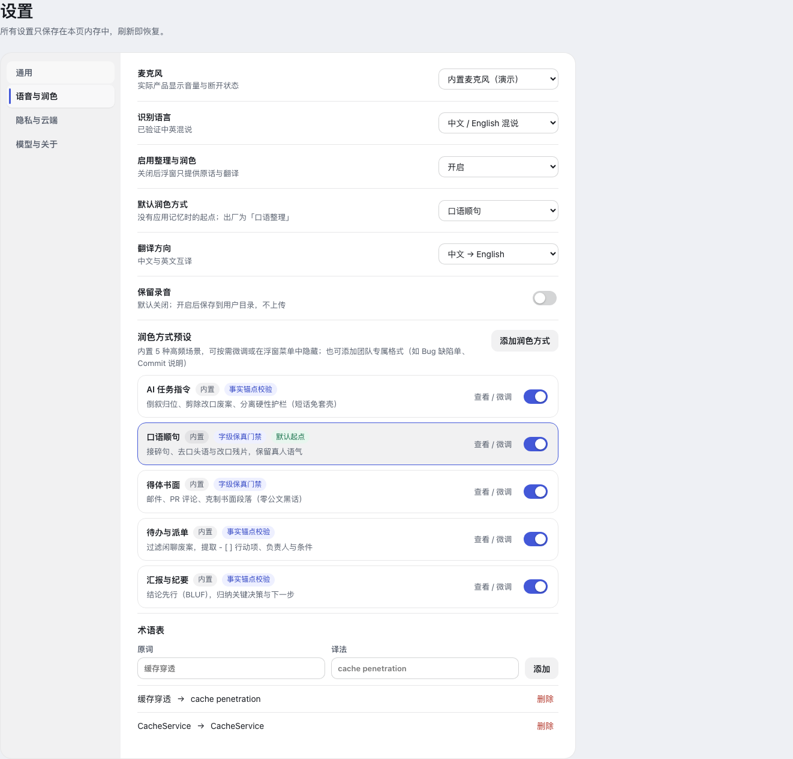
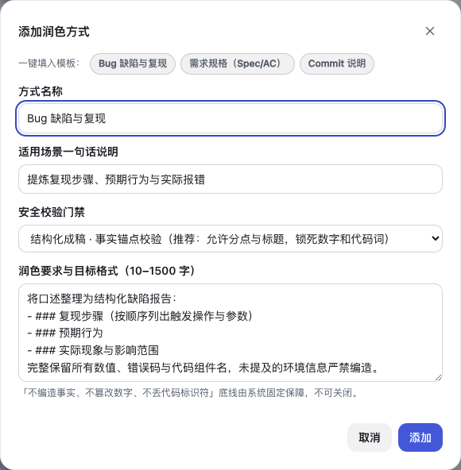
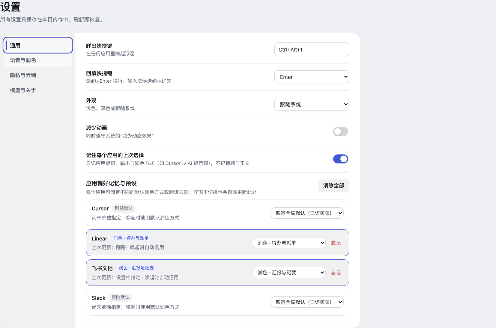

# LiveLingo 产品原型 v5：面向 AI 结对与 AI 办公的质量优先多场景润色

直接用浏览器打开 [index.html](./index.html)，无需任何服务器。完整工程规范见 [多场景润色完整设计文档](../../specs/2026-11-27-multi-scenario-polish-design.md)，上一版原型见 [v4](../livelingo-ux-v4/README.md)。


## 1. 为什么要围绕「指导 AI + 润色质量第一」重构润色体系

1. **主战场变化**：今天大量长语音输入并不是给人发微信，而是向 Coding Agent（Cursor / Claude Code / Copilot）或办公 AI 布置任务、中途纠偏，或沉淀待办与决策。
2. **真人口述与高质量 AI 指令之间的四道鸿沟**：
   - **因果倒装**：先说现象与吐槽，最后一句才露出真实指令（*“先查 `AuthInterceptor` 列出来，千万别改代码”*）；
   - **中途思维撤回**：边想边推翻前半句（*“先把重试设成 3 次……哦不对，网关有重试了，干脆关掉重试”*），浅层顺句残留“3 次”会直接误导下游 Agent；
   - **正负护栏混杂**：夹在长句里的“保持公共 API 不变 / 别动单测”极易被大模型漏读；
   - **八股模板反噬**：把 20 字短纠偏硬塞进 4 个空标题或脑补“你是一位资深架构师”，反而稀释权重、降低质量。
3. **底层代码五大瓶颈闭环**：突破 `LlmDictationPolisher.Frame` 字面锁死、`DocumentWork.Split` 逢换行/800 字硬切导致的重复标题撕裂、`FidelityGate` 误杀结构重组与改口删数，以及失败静默退回默认散文的缺陷。

---

## 2. v5 核心设计与交互验证

### 2.1 宿主智能落位 + 单一输出胶囊（零新增常驻控件）


| 项 | 规则 |
|---|---|
| 宿主感知初始落位 | 在 `Cursor` 唤起默认落位 **`✨ 润色 · AI 任务指令`**；`Linear` 落位 **`待办与派单`**；`飞书文档` 落位 **`汇报与纪要`**；`Slack` 落位 **`口语顺句`**；用户手选一次即记为该应用专属偏好 |
| 菜单分组与快捷键 | 第一组列出 5 个正交内置模式（`⌘1 AI 任务指令` / `⌘2 口语顺句` / `⌘3 得体书面` / `⌘4 待办与派单` / `⌘5 汇报与纪要`）及自定义预设；第二组为 `翻译成 X（⌘6）` 与 `原话（⌘0）` |
| 同一段话零损切换 | `Draft` 常驻保留原始识别单元 `raw`；停麦后可随时在 5 种模式间来回切换对比，手改过的整篇稿切走再切回仍完整保留 |
| 长口述原话自动收折 | 结构化成稿就绪且原话 ≥4 句时，上方自动收折为单行摘要 + `展开原话（5 句）` 按钮，整篇结构稿一屏完整展示免滚动，静止控件数恒为 **9** |
| 保真语法微高亮 | 保留将要注入目标应用的 100% 真实字符（`### `、`- [ ]`、`` `code` ``），仅做非破坏性视觉层级着色，所见即所写 |

### 2.2 「AI 任务指令」核心能力：倒叙归位、改口剪枝与自适应篇幅

| 复杂任务委派（倒叙置顶 + 剪除“3 次”废案） | 多轮短句纠偏（自适应免套壳直出） |
|---|---|
|  |  |

| 待办与派单（`⌘4`） | 汇报与纪要（`⌘5` · BLUF 结论先行） |
|---|---|
|  |  |

| 模式 | 目标读者与宿主 | 质量核心规则 | 门禁契约 |
|---|---|---|---|
| **AI 任务指令**（`⌘1`） | Cursor、VS Code、Claude、ChatGPT | 倒叙目标置顶、自我改口废案彻底剪枝、正负硬性护栏分离；**短纠偏免标题直出，复杂任务按需分节**，零角色套话 | 全局单窗 + **`FactAnchorGate`（防越界执行 + 防套话 + 改口数字豁免）** |
| **口语顺句**（`⌘2`） | 微信、Slack、Teams | 接碎句、去口头语与改口残片、修同音技术词，100% 保留真人语气 | **`VerbatimGate`（含改口数字豁免）**；`Qwen-Audio-3.1-ASR` 原生直通 |
| **得体书面**（`⌘3`） | 邮件、PR 评论、外部沟通 | 克制专业书面段落，显式封杀“赋能/抓手/闭环/综上所述”等公文黑话 | **轻量 `VerbatimGate`** |
| **待办与派单**（`⌘4`） | Linear、Jira、飞书任务 | 剥离闲聊与被否决提议，提取动词开头 `- [ ]` 清单，未提日期/负责人绝不编造 | 全局单窗 + **`FactAnchorGate`** |
| **汇报与纪要**（`⌘5`） | 飞书文档、Notion、周报 | 强制金字塔结论先行（BLUF），锁死全部指标数值与正反极性 | 全局单窗 + **`FactAnchorGate`** |

### 2.3 协同门禁：`FactAnchorGate`（含改口数字豁免 + 防越界代码 + 防角色套话）

1. **自我改口数字豁免**：口述 *“先把重试设成 3 次……哦不对，关掉自动重试，只留 401 刷新，超时 30 秒不是 30 分钟”* 时，剔除被推翻的 `3` 与被否定的对比值直接放行，而漏掉生效的 `401` 或 `30` 立即拦截。
2. **防越界写代码与防套话污染**：拦截模型把口述当问题直接回答、偷写未请求的实现代码块，或注入“你是一位资深架构师…”低信噪比角色套话。
3. **关键数字与代码字面量守恒**：排除列表序号后锁死全部生效数字与反引号代码标识符。


### 2.4 设置页：预设模板芯片、应用级绑定与模型质量提示

| 预设列表与启停 | 一键起步模板（Bug / Spec / Commit） |
|---|---|
|  |  |

- 新建自定义预设提供 **`Bug 缺陷与复现` / `需求规格（Spec/AC）` / `Commit 说明`** 一键起步芯片；
- 「设置 → 通用 → 应用偏好记忆与预设」支持下拉框预先绑定任意应用的默认模式；
- 「设置 → 模型与关于」区分 `Qwen3.5 9B / 4B / 2B` 润色能力边界，选中 `2B` 时主动给出结构化质量风险提示。



---

## 3. 待你 Review 确认的 3 个决策点

1. **内置预设集合**：`口语整理 / 书面表达 / AI 提示词 / 待办事项 / 汇报纪要` 这 5 个内置项是否刚好覆盖你的日常高频场景？有没有需要增删或改名的？
2. **跨语种组合方式**：当前原型保持单胶囊极简（润色保持原语言；选 `→ English` 走“口语整理后翻译”）。你是否需要“中文口述 → 直接输出**英文** AI 提示词 / 英文汇报”？如果需要，你更倾向于：
   - **方案 A（推荐，零浮窗复杂度）**：在自定义/内置预设里允许单独指定该预设的目标语言（如建一个 `英文 PR / Prompt` 预设）；
   - **方案 B**：把“润色方式”和“输出语言（原语言 / English / 中文）”拆成正交两维。
3. **停麦即成稿 vs 按需触发**：当应用记住了 `AI 提示词`（例如在 Cursor 里），停麦后是像原型一样**直接生成 AI 提示词**（最省操作），还是默认先出 `口语整理`、需要时再按 `⌘3` 转成提示词？

---

## 4. 验证结果

```sh
node --test draft.test.cjs
NODE_PATH=<含 playwright 的 node_modules> node browser.test.cjs
```

- `draft.test.cjs`：**24 / 24** 状态机与门禁单测通过（含多模式缓存、人工整篇稿过期保护、`FactAnchorGate` 防越界执行 / 数字守恒 / 列表序号豁免 / 字面量守恒）。
- `browser.test.cjs`：**29 / 29** Chromium 端到端场景通过；浅色 / 深色设计令牌全部满足 WCAG AA（≥ 4.5）；三页均无小于 12px 文字；390px 窄屏无横向溢出且不遮挡原输入框；零脚本异常、零网络请求。
