# LiveLingo 产品原型 v6：设置页用户体验与布局重构

直接用浏览器打开 [index.html](./index.html)，无需任何服务器。本原型专攻**设置窗口的信息架构、视觉层级、控件选型与多引擎模型管理体验重构**，并保留与浮窗的实时双向联动，供你 Review 确认后再落地到正式工程代码。

> 上一版浮窗多场景润色原型见 [v5](../livelingo-ux-v5/README.md)。

---

## 1. 现状诊断：为什么旧版设置页让人“不好理解、不好操作”

1. **信息架构严重失衡**：旧版 4 个平铺 Tab 中，「语音与翻译」单页塞进了 **9 行开关/下拉 + 5 张预设卡 + 9 行全文提示词文本框 + 口音纠错表单 + 术语表表单**，页面超长，用户根本分不清哪块管听写、哪块管润色、哪块管词库。
2. **平铺分割线缺乏视觉层级**：白底上用 1px 横线把所有设置项排成一整列，快捷键、外观、草稿清理、应用记忆混在一起，扫视成本高。
3. **过多黑盒 `<select>` 下拉**：外观（浅色/深色/跟随系统）、回填键（Enter / Ctrl+Enter）、默认输出（整理/翻译/原话）、翻译方向全部藏在下拉框里，需要点开才能看到有哪些选项。
4. **「模型」页纵向堆砌三套列表**：每个处理阶段下直接把「本机共享宿主（LM Studio/Ollama/Bionic）+ 云端端点 + 本机内置模型」纵向平铺，用户每次打开都要跨过 10–15 张卡片才能找到自己要切换的目标。
5. **高阶配置与普通设置同权曝光**：基础全文提示词大文本框、当前设备跑不动的大模型默认全部摊开，制造视觉焦虑与噪声。

---

## 2. v6 核心重构设计

### 2.1 侧边栏：3 组 6 域 + 全局设置搜索（`⌘K`）

将原本拥挤的 4 栏重构为**按用户意图分组的 6 个聚焦子页**，侧边栏自带图标、计数、实时隐私指示灯与即时搜索跳转：

| 分组 | 子页 | 职责边界 |
|---|---|---|
| **基础设置** | **通用** | 快捷键、视觉化外观选择、语言/动效、应用偏好记忆、临时草稿 |
| **基础设置** | **听写与翻译** | 麦克风与收音测音、听写启动习惯、默认输出三联卡、翻译方向 |
| **内容质量** | **润色场景** | 默认润色起点、宿主智能匹配、2 列预设卡片管理、折叠的高级提示词 |
| **内容质量** | **词库与纠错** | 内置研发热词预览 + 「口音误识别纠错」与「术语与翻译词表」清晰分栏 |
| **引擎与系统** | **模型与服务** | 硬件/隐私双区总览 + 4 段流水线导航 + **来源分段切换（本机内置 / 本机宿主 / 云端服务）** + 可视化存储占比条 |
| **引擎与系统** | **关于与诊断** | 品牌 Hero 卡、自动更新状态、一键复制脱敏诊断快照 |

### 2.2 界面总览截图

| 通用（卡片分组 + 主题视觉直选） | 听写与翻译（默认输出三联卡 + 测音电平） |
|---|---|
| 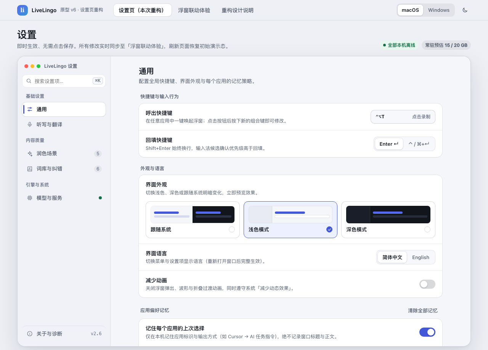 | 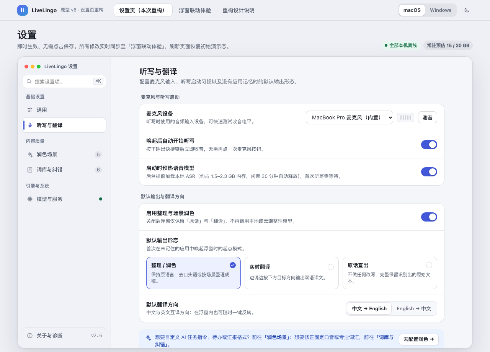 |

| 润色场景（2 列语义卡片 + 折叠高级提示词） | 词库与纠错（内置热词预览 + 纠错/术语分栏） |
|---|---|
| 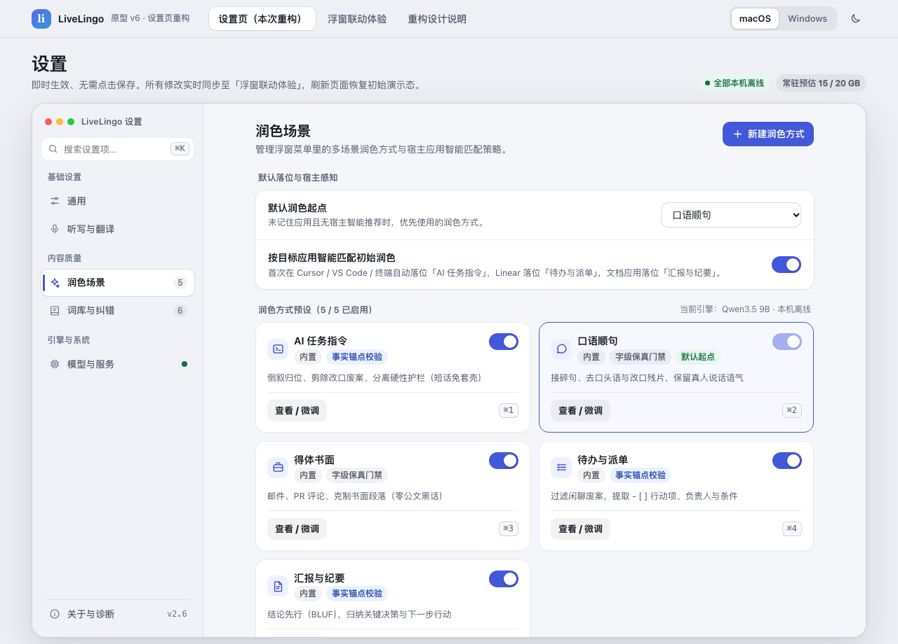 | 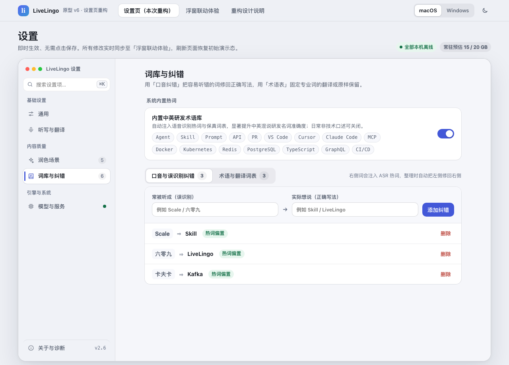 |

### 2.3 模型与服务页重构：从“三层纵向平铺”升级为“阶段 × 来源”解耦

- **顶部双区总览卡**：左侧展示本机硬件（M3 Max · 36 GB）与并发内存预算进度条，右侧展示数据流向隐私徽章与磁盘总占用快捷入口。
- **零额外内存热宿主条**：检测到本机 LM Studio 已常驻推荐模型时，单行提供「一键复用」与关闭按钮，不再挤占主列表。
- **4 段流水线 Tab**：`语音识别` / `整理与润色` / `翻译` / `本地存储` 一眼可见当前生效模型名与来源状态灯。
- **运行来源分段器**：选中任意阶段后，用 **`本机内置 | 本机宿主 | 云端服务`** 分段切换来源（带在线数与生效绿点），彻底告别长列表平铺；不兼容当前设备的超大模型自动折叠进 `
`。
- **存储可视化**：新增按阶段着色的水平占比条与可释放空间徽章，一键清理旧版本遗留权重。

| 模型 · 本机内置（浅色） | 模型 · 本机共享宿主（LM Studio / Ollama / Bionic） |
|---|---|
| 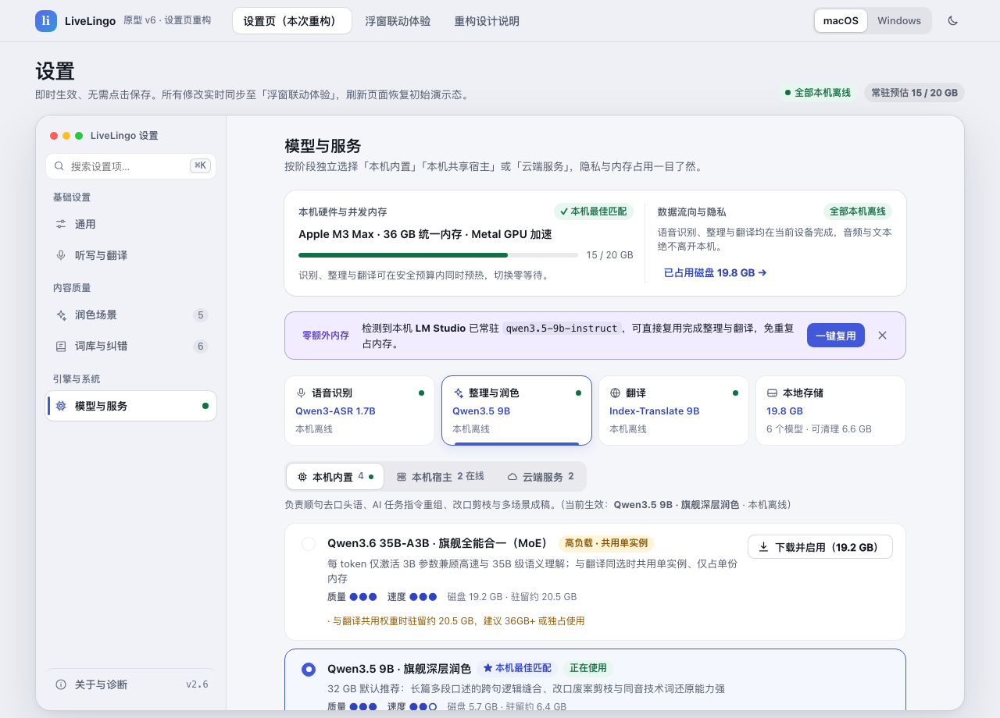 | 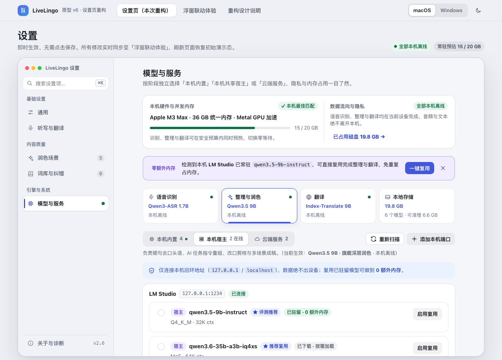 |

| 模型 · 云端服务（授权前确认） | 本地存储（分类占比条 + 清理释放） |
|---|---|
| 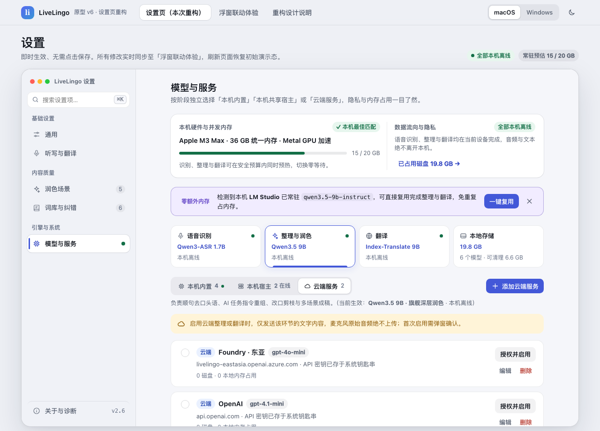 | 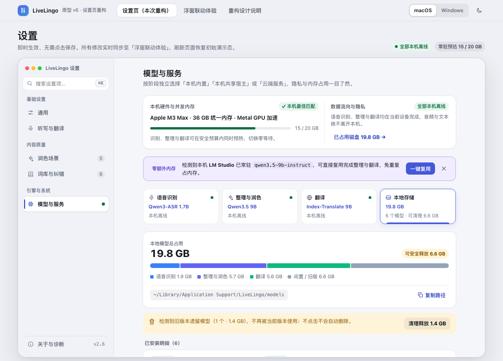 |

| 关于与诊断 | 深色模式（模型页） |
|---|---|
| 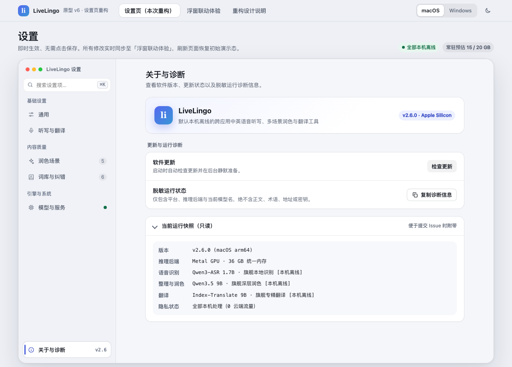 | 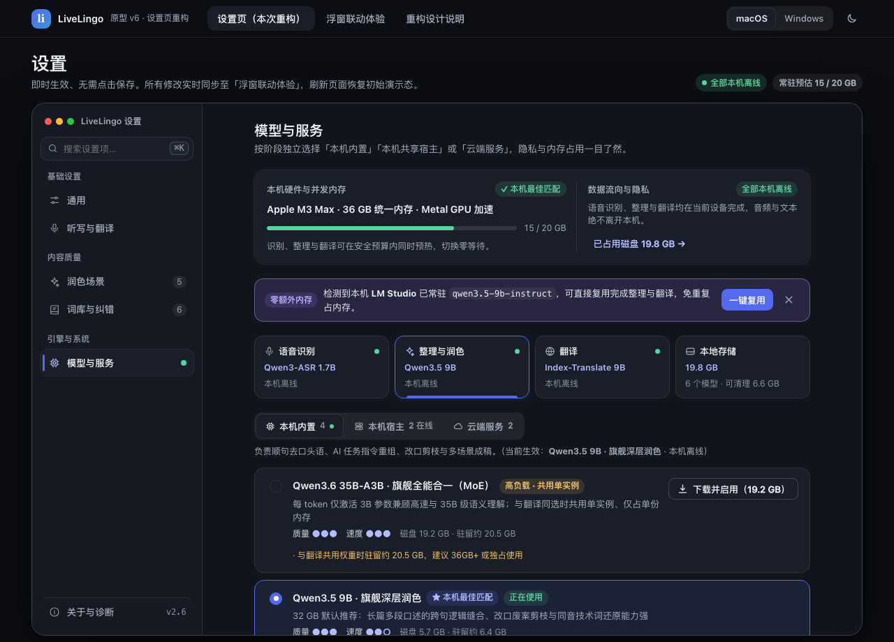 |

### 2.4 浮窗联动体验（完整保留宽屏分屏对照与现有能力）

「浮窗联动体验」页完整保留当前产品的浮窗交互能力：**默认宽屏左右分屏对照（左侧原话、右侧润色/译文独立滚动）**、顶栏一键切换宽屏/紧凑布局、`更多操作` 菜单中的「宽屏对照 / 整段处理 / 导入录音 / 导出 / 最近草稿」，并与设置页的主题、快捷键、润色预设和模型来源实时同步。

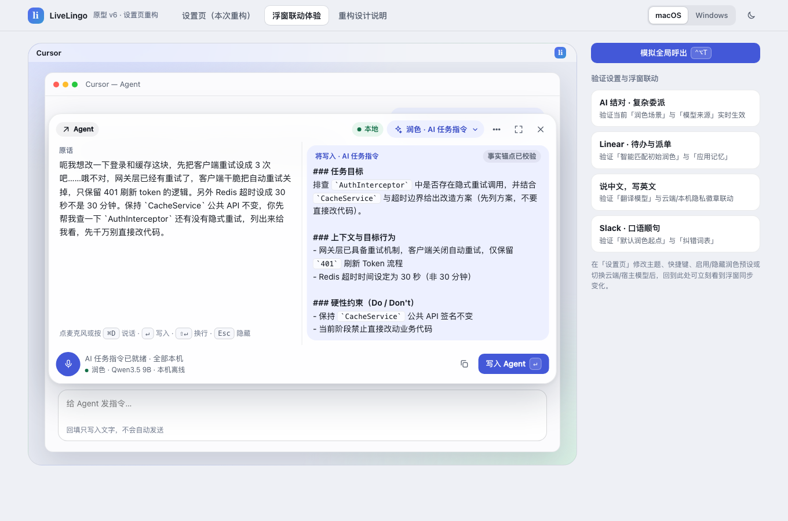

---

## 3. 建议 Review 重点

1. **导航拆分为 6 个域（3 组）**是否比旧版 4 栏更符合直觉？其中「润色场景」和「词库与纠错」是否值得作为独立一级侧边栏入口，还是你更希望它们在某个分类下以子 Tab 呈现？
2. **「模型与服务」页的来源分段器**（`本机内置 | 本机宿主 | 云端服务`）是否让多引擎选择清晰很多？是否需要在未选中的来源 Tab 上保留绿点提示当前生效位置？
3. **「通用」与「听写与翻译」中的可视化卡片直选**（主题缩略卡、默认输出三联卡、分段单选）的视觉密度和留白是否合适？
4. 如果你确认 v6 原型方向，下一步我会将这套结构与样式完整落地到桌面端 `src/LiveLingo.Desktop/Web/`（含 `31-settings.js`、`settings.css`、`tokens.css`、中英文 i18n 与前端交互测试）。
